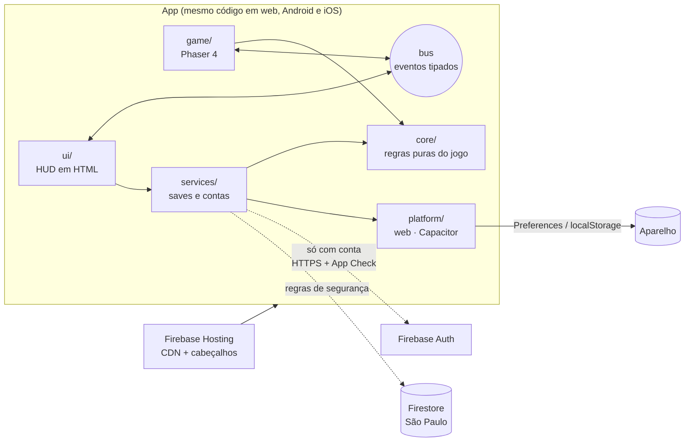
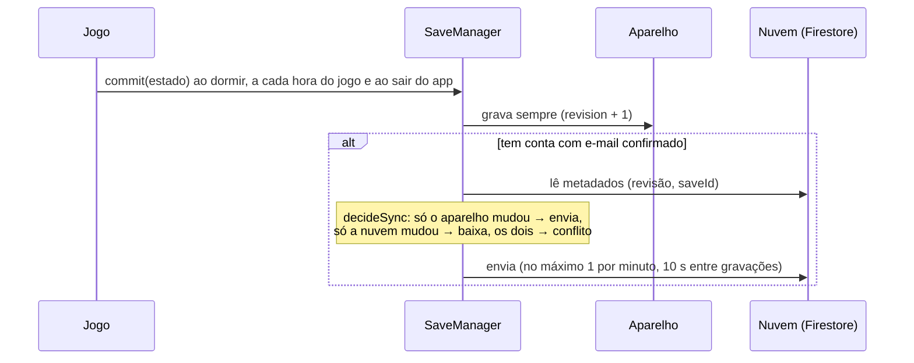

# Arquitetura

Uma base de código TypeScript roda em três plataformas: navegador, Android e iOS. O jogo funciona 100% offline. A conta online é opcional e serve só de backup do progresso.

## Camadas

| Pasta | Responsabilidade | Pode depender de |
|---|---|---|
| `src/core/` | Regras do jogo, dados, save (formato, validação, migração), decisão de sincronização | nada (TypeScript puro) |
| `src/game/` | Renderização e entrada (Phaser 4), arte trocável (`assets/manifest.ts`) | `core` |
| `src/ui/` | Interface em DOM: HUD, modais, conta, privacidade | `core`, `services` |
| `src/services/` | `SaveManager` (local-first + nuvem) e `Account` (fachada de contas) | `core`, `platform` |
| `src/services/firebase/` | Implementação concreta do backend, carregada sob demanda | `services`, Firebase |
| `src/platform/` | O que muda entre web, Android e iOS (armazenamento, ciclo de vida, botão voltar, arquivos) | Capacitor |
| `src/app/` | Ambiente (`env.ts`) e mapa de eventos (`events.ts`) | — |
| `src/main.ts` | Raiz de composição: cria cada peça uma vez | tudo |

A regra que protege o projeto é que `core/` não conhece Phaser, DOM, Capacitor nem Firebase. Por isso as regras do jogo rodam nos testes (Node), e dá para trocar o motor gráfico ou o backend sem reescrevê-las.

## Fluxo do save (local-first)

- **Sincronização em três vias** (`core/sync.ts`): compara aparelho, nuvem e a última revisão em comum (`syncedRevision`). Nada é descartado em silêncio. Num conflito o jogador escolhe, e a versão descartada fica como cópia de segurança local.
- **Validação defensiva** (`core/state/schema.ts`): todo save que vem do disco, da nuvem ou de um arquivo é reconstruído campo a campo, com limites. Um save adulterado é recusado e não chega a quebrar o jogo.
- **Migrações versionadas** (`core/state/migrations.ts`): o formato tem versão (`SAVE_SCHEMA`). Saves antigos são convertidos, e as migrações nunca são apagadas.

## Por que escala

- Não há servidor próprio para manter, escalar ou derrubar. Arquivos estáticos ficam em CDN, e o Firestore e o Auth escalam automaticamente.
- Cada jogador custa no máximo 1 leitura e 1 gravação por minuto de jogo, e só quem tem conta. Convidados custam zero, porque nem baixam o código do Firebase.
- Recursos futuros que precisem de servidor (compras, eventos) entram como Cloud Functions isoladas, com App Check e limites próprios.

## Decisões (ADRs resumidos)

1. **Phaser 4 + TypeScript + Capacitor 8** em vez de Unity ou Godot. Uma base web-first gera navegador, Android e iOS. O login nativo do Google e da Apple é maduro via plugin. É possível trabalhar só com código e testar no Node e no navegador.
2. **Firebase** em vez de Supabase ou backend próprio:
   - App Check com Play Integrity/App Attest contra clientes falsos;
   - plano gratuito com teto rígido, que impede conta inesperada;
   - Firestore na região de São Paulo;
   - regras de segurança testáveis no emulador.

   Para evitar dependência de um fornecedor só (lock-in), tudo passa pelas interfaces `AuthService` e `CloudSaveStore` (`services/account/types.ts`).
3. **Local-first com conta opcional.** Atende à minimização da LGPD, à exigência da Apple de não obrigar login (5.1.1), ao uso offline e ao custo baixo.
4. **Firebase carregado sob demanda.** Convidados não fazem nenhuma chamada a servidores, e o pacote inicial fica menor.
5. **HUD em DOM com templates que escapam HTML por padrão** (`ui/dom.ts`), além de CSP estrita. Isso fecha a principal porta de XSS.
6. **Licença proprietária** (todos os direitos reservados). Dá para abrir depois; o contrário não.
