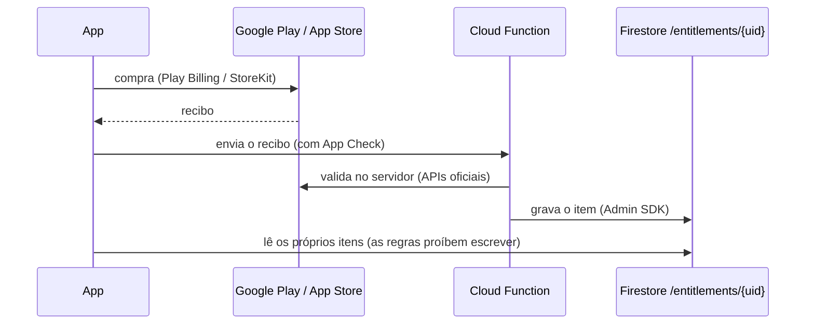

# Monetização (backlog): grátis, justo e sem pay-to-win

## Regras inegociáveis

1. **O jogo base é completo e gratuito.** Nada essencial fica atrás de pagamento.
2. **Nada que dê vantagem:** não se vende tempo, sementes, dinheiro do jogo ou crescimento acelerado. Num jogo sem punição, isso nem teria sentido.
3. **Nada aleatório pago.** Sem loot box, gacha ou "caixa surpresa". Além de ética, é **proibido** pelo ECA Digital (Lei nº 15.211/2025, art. 20) para jogos com acesso provável de crianças e adolescentes.
4. **Sem anúncios.** Eles quebram o clima cozy, exigem SDKs de rastreamento e complicam LGPD, ECA Digital e a política para famílias da Play.
5. **Preço claro e conteúdo conhecido antes de comprar.** Sem moeda premium intermediária.

## Ideias, da mais simples para a mais trabalhosa

| Ideia | O que é | Observações |
|---|---|---|
| **Apoie o jogo** | Compra única "Muda de pequi" (valor livre em 2–3 faixas) com um agradecimento: nome nos créditos e um enfeite cosmético na varanda | Mais simples; bom teste de demanda |
| **Cosméticos** | Roupas para Carol e Tomás, bandanas e coleiras para os pets, decorações da casa, temas sazonais (São João, Natal no cerrado) | Comprado = seu para sempre, em todos os aparelhos (exige conta) |
| **Expansões** | Capítulos novos: Chapada, feira da cidade, apicultura. Base completa, expansão opcional | Maior valor percebido |
| **Versão PC premium** | Steam ou itch.io com preço único (com extras cosméticos), mantendo o mobile grátis | Diversifica a receita fora das lojas mobile |
| **Fora do jogo** | Trilha sonora, artbook, camisetas/prints da arte, financiamento coletivo (Catarse/Apoia.se) para devlogs | Constrói comunidade; o portfólio agradece |

## Como implementar quando chegar a hora (sem brechas)

- A regra `/entitlements/{uid}` já existe e está testada: **o cliente só lê**.
- Itens digitais dentro do app precisam usar o **faturamento da loja** (Google Play Billing / Apple IAP). Confira as regras vigentes de pagamentos alternativos no Brasil quando for implementar.
- Exige o plano Blaze (Cloud Functions). Junto vêm alertas de orçamento e App Check imposto.
- O Código de Defesa do Consumidor se aplica: direito de arrependimento e informações claras. Os reembolsos seguem as lojas.
- Fiscal: receita das lojas vem do exterior. Converse com um contador sobre pessoa física (carnê-leão) ou abrir empresa.
